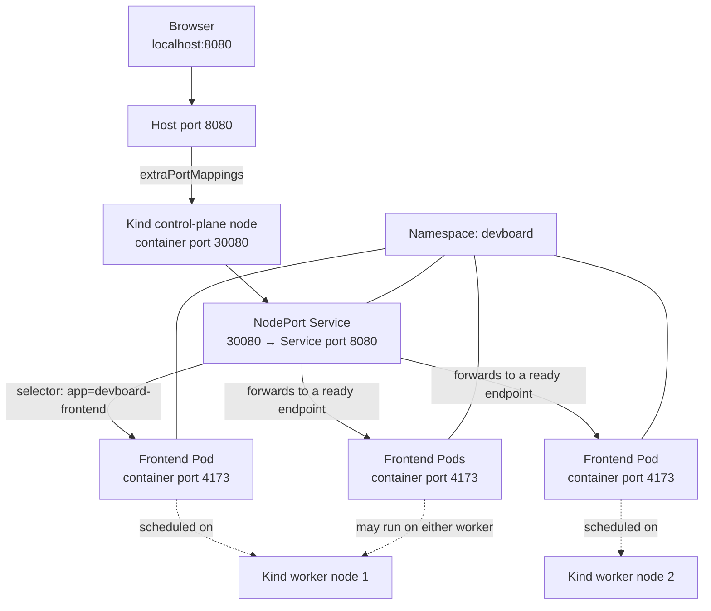

# Deploy DevBoard Frontend on Kubernetes using Kind

This guide explains how to connect a Kubernetes Namespace, Pod, Deployment, Service, Kind worker nodes, and your local browser using your `devboard-frontend` application.

We will cover:

1. Step 1 — Explain each YAML file and correct errors.
2. Step 2 — Commands to create the Kind cluster and deploy the application.
3. Step 3 — Verification and troubleshooting commands.
4. Step 4 — How Namespace, Deployment, Pods, and Services connect.
5. Step 5 — Architecture diagram showing ports `8080`, `30080`, and `4173`.

## Step 1: Understand and correct the YAML files

### 1.1 Namespace — `namespace.yml`

**Purpose:** A Namespace logically separates Kubernetes resources. Your frontend Deployment, Pods, and Service will all belong to the `devboard` Namespace.

```yaml
apiVersion: v1
kind: Namespace
metadata:
  name: devboard
```

Explanation:

- `apiVersion: v1` — Uses the core Kubernetes API.
- `kind: Namespace` — Creates a Namespace.
- `metadata.name: devboard` — Names the Namespace `devboard`.

Your original `name: devboard. namespace.yml` is invalid because the filename must not be part of the YAML value.

### 1.2 Standalone Pod — `pod.yml`

**Purpose:** Creates one frontend Pod directly. This is useful for learning and testing, but your actual application should normally run through a Deployment.

```yaml
apiVersion: v1
kind: Pod
metadata:
  name: devboard-frontend
  namespace: devboard
  labels:
    app: devboard-frontend
spec:
  containers:
    - name: devboard-frontend
      image: anandkumarprajap/devboard-frontend:latest
      ports:
        - containerPort: 4173
```

Important details:

- `namespace: devboard` — Places the Pod in the `devboard` Namespace.
- `image` — Tells Kubernetes which container image to run.
- `containerPort: 4173` — Documents the port the frontend container listens on; it does not publish that port to your laptop.
- `labels` — Identifies the Pod using `app: devboard-frontend`.

**Important:** Do not create this standalone Pod alongside your five-replica Deployment for normal operation. They are separate workloads, and the Service selector would match both. Use the Deployment for the final setup.

### 1.3 Deployment — `frontend-deployment.yml`

**Purpose:** Maintains five frontend Pod replicas and replaces Pods when necessary.

```yaml
apiVersion: apps/v1
kind: Deployment
metadata:
  name: devboard-frontend-deployment
  namespace: devboard
  labels:
    app: devboard-frontend
spec:
  replicas: 5
  selector:
    matchLabels:
      app: devboard-frontend
  template:
    metadata:
      labels:
        app: devboard-frontend
    spec:
      containers:
        - name: devboard-frontend
          image: anandkumarprajap/devboard-frontend:latest
          ports:
            - containerPort: 4173
```

How it works:

- `replicas: 5` — Requests five frontend Pods.
- `selector.matchLabels` — Tells the Deployment which Pods it manages.
- `template.metadata.labels` — Applies the matching label to every new Pod.
- `containerPort: 4173` — The application port inside each Pod.

The selector and Pod-template labels must match. Your original `containerPort: 4173.` is invalid because of the trailing period.

### 1.4 Service — `frontend-service.yml`

**Purpose:** Provides a stable network endpoint for all frontend Pods.

```yaml
apiVersion: v1
kind: Service
metadata:
  name: devboard-frontend-service
  namespace: devboard
spec:
  type: NodePort
  selector:
    app: devboard-frontend
  ports:
    - protocol: TCP
      port: 8080
      targetPort: 4173
      nodePort: 30080
```

Your original Service had `type: NodePort` twice. Keep only one `type` entry.

| Setting | Meaning |
|---|---|
| `port: 8080` | Service port inside the Kubernetes network |
| `targetPort: 4173` | Port on the selected frontend Pods |
| `nodePort: 30080` | Port exposed on each Kubernetes node |
| `selector` | Finds Pods labelled `app: devboard-frontend` |

The NodePort must be in the default range `30000–32767`; `30080` is valid.

The port flow is:

`Browser → localhost:8080 → Kind node:30080 → Service:8080 → Frontend Pod:4173`

The Service selects ready, matching Pods and distributes connections between them.

### 1.5 Kind cluster configuration — `kind-config.yml`

**Purpose:** Creates a local Kubernetes cluster using Docker containers as Kubernetes nodes and maps a port on your computer to the cluster.

```yaml
kind: Cluster
apiVersion: kind.x-k8s.io/v1alpha4
name: tws-cluster

nodes:
  - role: control-plane
    image: kindest/node:v1.35.0
    extraPortMappings:
      - containerPort: 30080
        hostPort: 8080
        protocol: TCP

  - role: worker
    image: kindest/node:v1.35.0

  - role: worker
    image: kindest/node:v1.35.0
```

Explanation:

- `name: tws-cluster` — Names the Kind cluster.
- `control-plane` — Runs control-plane components.
- `worker` — Runs application workloads.
- `extraPortMappings` — Forwards your computer's port `8080` to port `30080` inside the control-plane node container.
- `containerPort: 30080` here is the Kind node container's port, not the frontend application's port.
- `hostPort: 8080` is the port you open in your browser.

**Remember:** This configuration maps port `8080` to the control-plane node. You do not need to expose port `4173` directly on your laptop because the Service forwards traffic to it.

## Step 2: Commands to create the cluster and deploy the application

### 2.1 Check your environment

Run these commands on the Linux machine or EC2 instance where Docker and Kind are installed.

```bash
docker --version
kind version
kubectl version
```

Check whether your cluster already exists:

```bash
kind get clusters
kubectl config current-context
```

### 2.2 Create the Kind cluster

Run this command from the directory containing `kind-config.yml`:

```bash
kind create cluster --config kind-config.yml
```

Verify the nodes:

```bash
kubectl get nodes -o wide
```

Expected structure:

```text
NAME                      STATUS   ROLES
tws-cluster-control-plane Ready    control-plane
tws-cluster-worker        Ready    <none>
tws-cluster-worker2       Ready    <none>
```

The exact worker names may differ. If `tws-cluster` already exists, do not run cluster creation again expecting it to update the existing port mappings. Existing clusters need to be recreated to apply changed Kind configuration; preserve any important workloads first.

### 2.3 Create the Namespace

```bash
kubectl apply -f namespace.yml
```

Verify:

```bash
kubectl get namespaces
kubectl get namespace devboard
```

### 2.4 Deploy the frontend

Apply the Deployment first, then the Service:

```bash
kubectl apply -f frontend-deployment.yml
kubectl apply -f frontend-service.yml
```

Wait for the rollout:

```bash
kubectl rollout status deployment/devboard-frontend-deployment -n devboard
```

Verify all resources:

```bash
kubectl get all -n devboard
```

Check the five frontend replicas:

```bash
kubectl get pods -n devboard -o wide
```

Expected result: five Pods, each with `READY` showing `1/1` once the application is running correctly.

### 2.5 Test the application

First verify the Service and its endpoints:

```bash
kubectl get svc devboard-frontend-service -n devboard
kubectl get endpoints devboard-frontend-service -n devboard
```

Then, if the Kind cluster is running on your local computer, open:

[http://localhost:8080](http://localhost:8080)

If Kind is running on an EC2 instance, open:

`http://EC2-PUBLIC-IP:8080`

Replace `EC2-PUBLIC-IP` with your instance's actual public IP and allow inbound TCP `8080` in the EC2 security group if you intend to access it externally. Restrict access to trusted IP addresses where possible.

## Step 3: Verification and troubleshooting commands

Use these commands when a Pod is not starting, the Service has no endpoints, or the frontend is not opening.

| What to check | Command |
|---|---|
| Namespace | `kubectl get ns` |
| Deployments | `kubectl get deployments -n devboard` |
| Pods and nodes | `kubectl get pods -n devboard -o wide` |
| Services | `kubectl get svc -n devboard` |
| Service endpoints | `kubectl get endpoints -n devboard` |
| Pod details | `kubectl describe pod POD_NAME -n devboard` |
| Pod logs | `kubectl logs POD_NAME -n devboard` |
| Deployment events | `kubectl describe deployment devboard-frontend-deployment -n devboard` |
| Namespace events | `kubectl get events -n devboard --sort-by=.metadata.creationTimestamp` |

Replace `POD_NAME` with a real Pod name from `kubectl get pods`.

### Common problems and fixes

**Problem 1: `ImagePullBackOff`**

```bash
kubectl describe pod POD_NAME -n devboard
```

Check that `anandkumarprajap/devboard-frontend:latest` exists in Docker Hub and that the image is accessible.

**Problem 2: `CrashLoopBackOff`**

```bash
kubectl logs POD_NAME -n devboard
kubectl logs POD_NAME -n devboard --previous
```

Check the startup command, environment variables, and application logs.

**Problem 3: Service has no endpoints**

```bash
kubectl get pods -n devboard --show-labels
kubectl describe svc devboard-frontend-service -n devboard
kubectl get endpoints devboard-frontend-service -n devboard
```

The Service selector must match the labels on the Deployment's Pods:

```yaml
selector:
  app: devboard-frontend
```

**Problem 4: Service exists, but the browser cannot connect**

Check the container port, Kind mapping, and application listener:

```bash
kubectl get svc devboard-frontend-service -n devboard
kubectl get nodes
docker ps
```

The frontend must actually listen on port `4173` and normally bind to `0.0.0.0`, rather than only `127.0.0.1`, inside its container. A `containerPort` declaration alone does not make an application listen on that port.

If the Kind cluster is on EC2, also check its security group and whether the host is listening on port `8080`.

**Problem 5: Deployment changes are not appearing**

```bash
kubectl rollout status deployment/devboard-frontend-deployment -n devboard
kubectl rollout history deployment/devboard-frontend-deployment -n devboard
kubectl rollout restart deployment/devboard-frontend-deployment -n devboard
```

For a changed image, update the Deployment image explicitly or use a newly tagged image. Reusing `latest` may cause old cached images to be used.

## Step 4: How Namespace, Deployment, Pod, and Service connect

The four resources have different responsibilities.

1. **Namespace — `devboard`**  
   Organizes the resources in one logical scope. It does not automatically connect them.

2. **Deployment — `devboard-frontend-deployment`**  
   Maintains five replicas using a Pod template and matching labels.

3. **Pods — `app: devboard-frontend`**  
   Run the frontend containers. Each selected Pod serves the application on port `4173`.

4. **Service — `devboard-frontend-service`**  
   Selects matching Pods and provides a stable endpoint on Service port `8080` and NodePort `30080`.

### How Kubernetes identifies the frontend

Your Deployment contains:

```yaml
metadata:
  name: devboard-frontend-deployment
  namespace: devboard
```

Its Pod template contains:

```yaml
labels:
  app: devboard-frontend
```

The Service contains:

```yaml
metadata:
  name: devboard-frontend-service
  namespace: devboard
spec:
  selector:
    app: devboard-frontend
```

Kubernetes uses the Namespace and labels/selectors, not the Deployment's name, to associate the Service with its frontend Pods.

To list only the matching Pods:

```bash
kubectl get pods -n devboard -l app=devboard-frontend
```

To inspect the Service's selected Pods:

```bash
kubectl describe svc devboard-frontend-service -n devboard
```

### Connect to the Service by DNS

Other Pods in the same Namespace can access the frontend using:

```text
http://devboard-frontend-service:8080
```

The fully qualified Kubernetes Service DNS name is:

```text
devboard-frontend-service.devboard.svc.cluster.local
```

For example, a backend Pod can make an HTTP request to the frontend Service using its Service DNS name and port `8080`. This is internal cluster networking; it does not require the browser's host port.

## Step 5: Architecture diagram — host, Kind nodes, Service, and Pods



*Illustration only: five replicas may be distributed across available nodes; Kubernetes does not guarantee a particular Pod placement without scheduling constraints. The Kind port mapping shown forwards host port 8080 to the control-plane node's port 30080.*

### Understand the three ports

#### `8080` — Host port

Your computer or EC2 host. The browser connects to this port. Kind maps it to the control-plane node's port `30080`.

#### `30080` — NodePort

Kind node / Service entry. Kind forwards traffic to this port. The Kubernetes NodePort Service forwards it to an appropriate ready frontend endpoint.

#### `4173` — Container port

The port on which the Vite preview server or your configured frontend process listens inside each Pod.

**Important distinction:** Service port `8080` is an internal Kubernetes Service port. It is not the same as host port `8080`, even though both numbers are identical. The traffic path is:

`Host 8080 → Kind node 30080 → Service 8080 → Pod 4173`

## Final checklist

- [ ] Kind cluster created with the port mapping.
- [ ] Namespace `devboard` exists.
- [ ] Deployment reports 5 ready replicas.
- [ ] Service selector matches `app=devboard-frontend`.
- [ ] Service endpoints list ready Pod IPs.
- [ ] Frontend listens on `0.0.0.0:4173`.
- [ ] Browser can access host port `8080`.

